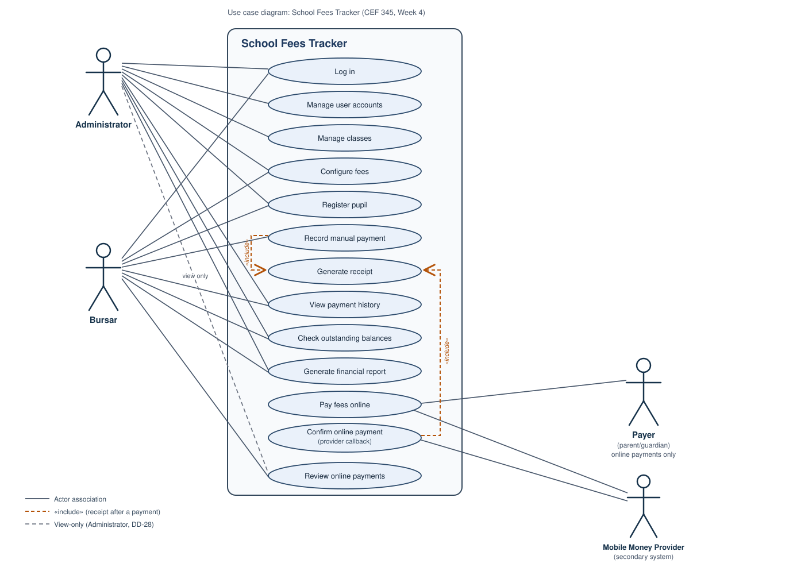

# Software Requirements Specification: School Fees Tracker

**SRS v0.2** · 2026-11-15 · Status: Draft for review
**Project:** School Fees Tracker, private nursery and primary school in Cameroon (CEF 345, Week 4 Requirements assignment)
**Document standard:** modelled on IEEE 830-1998 and ISO/IEC/IEEE 29148:2018

| Version | Date | Change |
|---|---|---|
| 0.2 | 2026-11-15 | Complete draft: full requirement set (FR-01 to FR-16, NFR-01 to NFR-08), MoSCoW table, design decisions (§10), references. Revised 2026-11-15: OQ-1 resolved as DD-24 (balances start at zero; record import out of scope); DD-25 to DD-28 consistency fixes; section 5 use cases added (diagram and UC-01 to UC-03); DD-29 payer confirmation screen (UC-02); UC-03 alternative flow 3a rewritten as user-visible behaviour and 4a removed (covered by FR-09.3). Requirement IDs and MoSCoW priorities unchanged throughout. |

Conventions:

- The requirement text is written to be specific and testable, following ISO/IEC/IEEE 29148 ("shall" statements, measurable criteria). **IDs and MoSCoW priorities are unchanged from the approved requirement list.** No requirement was silently added, removed, or re-scoped.
- Points decided after review are recorded in **Design decisions** (§10) and referenced as *(DD-n)*. No open questions remain as of this revision (§9).
- Verification methods: **T** = test, **D** = demonstration, **I** = inspection, **A** = analysis.

---

## 1. Introduction

### 1.1 Purpose

This document specifies the software requirements for the **School Fees Tracker**, a responsive web application that lets a private nursery and primary school in Cameroon record fee payments for pupils and track outstanding balances. It is the baseline for design, implementation, and verification of the system, and the reference for the Week 4 Requirements deliverable (CEF 345).

Intended audience: the development team, the course assessor, and the school stakeholders who will review the system's scope.

### 1.2 Scope

The School Fees Tracker will:

- register pupils and their classes;
- let authorised staff configure fees per class and academic year;
- let the Bursar record manual payments (cash, bank transfer, Mobile Money);
- accept payer-initiated online payments via Mobile Money (MTN MoMo / Orange Money);
- compute remaining balances, generate receipts, and produce expected/received/outstanding reports;
- restrict staff access to two roles, **Administrator** and **Bursar**; the **Payer** (parent/guardian) is an external actor for online payments only and holds no staff account.

All monetary amounts are in **XAF** (Central African CFA franc), the sole currency of the system.

The following are **explicitly out of scope** (see §7): SMS notifications, parent self-service accounts, payroll, exam results, inventory.

Evidence base for this specification is **secondary desk research only** (see `docs/field-notes/secondary-research.md`); no school visit or interview was performed. No open questions remain as of this revision (§9).

### 1.3 Definitions, acronyms and abbreviations

| Term | Definition |
|---|---|
| SRS | Software Requirements Specification |
| FR / NFR | Functional / Non-Functional Requirement |
| MoSCoW | Must / Should / Could / Won't prioritisation |
| RBAC | Role-Based Access Control |
| XAF | Central African CFA franc (BEAC zone); whole francs, no minor subunit |
| MTN MoMo / Orange Money | The two dominant mobile money schemes in Cameroon |
| PSP | Payment Service Provider |
| EMI | Electronic Money Institution |
| BEAC / COBAC / CEMAC | Bank of Central African States / its Banking Commission / Central African Economic and Monetary Community |
| CENTIF / CNDP | Cameroon's financial intelligence unit (AML) / national data protection authority |
| Bursar | Staff member who records payments and manages day-to-day fee operations |
| Administrator | Staff member who configures the system (users, classes, fees) |
| Payer | Parent/guardian initiating an online payment; external actor, no staff account |
| Manual payment | A payment recorded in the system by the Bursar after money is received outside the app |
| Online payment | A payer-initiated Mobile Money payment confirmed electronically by the provider |
| Receipt number | Unique identifier generated per successful payment (FR-06) |
| Academic year | The school's fee/academic cycle against which fees are configured (FR-03) |

### 1.4 References

See §8.

---

## 2. Overall Description

### 2.1 Product perspective

The School Fees Tracker is a new, standalone responsive web application. It is greenfield as decided: every pupil's balance starts at zero at launch and importing existing paper or Excel records is out of scope for v1 (DD-24). It does not hold payer funds or act as an e-money issuer; online payments flow through licensed MTN MoMo / Orange Money rails, directly or via a licensed aggregator (see Constraints, §2.6). It coexists with the school's existing manual processes, which it replaces for fee recording only.

Context (actors and external systems):

- **Administrator**: configures classes, fees, user accounts; views records and reports.
- **Bursar**: records payments, reviews online payments, views balances and reports.
- **Payer (parent/guardian)**: initiates an online Mobile Money payment for a specific pupil; never authenticates as staff.
- **External systems:** MTN MoMo and Orange Money payment APIs (or an aggregator providing both), used for payer-initiated online payments.

### 2.2 Product functions (summary)

- Pupil registration and class management (FR-01, FR-02)
- Fee configuration per class and academic year (FR-03)
- Manual payment recording: cash / bank transfer / Mobile Money (FR-04)
- Automatic balance calculation (FR-05)
- Unique receipt generation (FR-06)
- Payment history, outstanding-balance identification, and reporting (FR-07 to FR-10)
- User account and role management (FR-11)
- Audit logging of payment creation and corrections (FR-12)
- Online Mobile Money payment: initiation, automatic recording on provider confirmation, failure handling and bursar review (FR-13 to FR-16)

### 2.3 Stakeholders

| Stakeholder | Interest |
|---|---|
| School ownership / management (sponsor) | Fee collection integrity, auditability, cash-flow visibility |
| Administrator | Configuration (pupils, classes, fees, users); oversight |
| Bursar | Fast, accurate payment recording; receipt and reconciliation workflow |
| Payer (parent/guardian) | Pay a child's fees from a phone without visiting the school |
| Payment providers (MTN MoMo, Orange Money) / aggregator | Integration partner; confirmation callbacks/webhooks |
| Course assessor (CEF 345) | Conformance to the Week 4 requirements exercise |

### 2.4 User characteristics

- **Administrator:** office staff; comfortable with web applications; infrequent-to-moderate use (setup and per-year changes).
- **Bursar:** office staff; heavy daily use; not an IT specialist. NFR-08 targets recording a manual payment in under 1 minute after training.
- **Payer:** general public; variable digital literacy; uses a basic smartphone and a Mobile Money wallet (possibly via USSD); has no account on the system.
- All staff users operate within a single school (single tenant, DD-13).

### 2.5 Operating environment

- Responsive web application, accessible over HTTPS from current versions of Chrome, Edge, Firefox and Safari, on desktop, tablet and smartphone viewports (NFR-05).
- Server-side persistence in a relational database (choice of DBMS deferred to design); internet connectivity required for online payments and for system access.
- No client installation; no card terminal; no direct handling of PINs (NFR-06).

### 2.6 Constraints

**Research-derived constraints** (from `docs/field-notes/secondary-research.md`; these inform design and are *not* additional FR/NFR IDs):

- **C-1. Currency and arithmetic:** all amounts are XAF, whole francs; no decimal/fractional-unit handling anywhere in storage, computation or display.
- **C-2. Two mobile money rails:** online payment integration must support **both** MTN MoMo and Orange Money; single-operator integration is not acceptable (sources disagree on exact shares: Orange ~52% / MTN ~45% per 2026 market commentary; ~40/40 in 2019 official citations; the convergence is unambiguous).
- **C-3. Licensed rails only:** payments flow via licensed operator APIs or a licensed aggregator; the system shall not issue e-money, hold payer balances, or bypass operator authorization (BEAC/COBAC framework). Confirmation must rely on provider callback/reconciliation, not client-side claims.
- **C-4. AML/record transparency:** transaction records (reference, method, amount, timestamp, identity) must be retained and auditable, anticipating CENTIF reporting expectations; access is role-restricted (NFR-02) and payment events are logged (FR-12).
- **C-5. Data protection:** personal data (pupil/guardian names, phones) is stored and processed only as needed; processing respects CNDP (national data protection authority) expectations; no sharing beyond the school and its payment providers.
- **C-6. Configurable fees, never constants:** fee amounts, classes per academic year and academic-year boundaries change annually and by class; they must be configuration data entered by authorised staff (FR-03), never hard-coded.
- **C-7. Fee scale and part-payments:** desk research indicates annual local private fees on the order of a few hundred thousand XAF with part-payments common; the data model and balance computation must support part-payments (FR-04, FR-05) and per-academic-year fee assignment (FR-03). There is no fixed instalment schedule in v1 (DD-02).
- **C-8. Network realities:** both staff and payers may rely on mobile data; online confirmation depends on provider latency and availability, so FR-14/FR-15/FR-16 must tolerate delayed, duplicated or out-of-order provider notifications.
- **C-9. No primary evidence:** all requirements rest on desk research and the approved requirement list; no school-specific practice is assumed as fact (see Assumptions, §2.7, and Design decisions, §10).
- **C-10. Public repository:** the source repository is public; secrets must never be committed (reinforced by NFR-06).

**Technical/project constraints:**

- **C-11.** Two staff roles only (Administrator, Bursar); no additional roles shall be introduced without a change request.
- **C-12.** Payer is external; Payer shall have no staff account and no access to staff functions.
- **C-13.** No SMS notifications (see Out of scope, §7); online payment UX must not depend on SMS being sent by this system.

### 2.7 Assumptions and dependencies

- **A-1.** The school will hold (or obtain) merchant arrangements with MTN MoMo and Orange Money, directly or via an aggregator, before online payments go live. API credentials are provisioned outside the repository (C-10, NFR-06).
- **A-2.** Pupils/guardians pay against a per-pupil, per-academic-year balance (DD-04); each payment (manual or online) is attached to exactly one pupil.
- **A-3.** The school provides the fee schedule per class per academic year at configuration time (data entry, not development).
- **A-4.** Academic-year boundaries are school-defined and entered as configuration; there is no instalment schedule in v1 (DD-02).
- **A-5.** Single school, single tenant; no multi-campus consolidation in this revision (DD-13).
- **A-6.** Staff devices have a current browser and internet access; the app is not required to work fully offline.
- **A-7.** Receipts are on-screen records with a print-friendly layout (browser print); a dedicated PDF export is a possible later change (DD-12).
- **A-8.** Guardians' MoMo accounts and phones are available to initiate online payments (FR-13); the system does not verify wallet ownership beyond the provider flow.

---

## 3. Functional Requirements

Each requirement keeps the source ID and MoSCoW priority. Statements are written with ISO/IEC/IEEE 29148-style "shall" wording and measurable acceptance criteria. Decisions applied during review are referenced as *(DD-n)*; no open questions remain (§9).

### FR-01: Pupil registration (Priority: Must; Verification: T)

**FR-01.1** The system shall provide a pupil registration function capturing at minimum: pupil full name, admission number, class, guardian full name, guardian phone number, and **enrolment date**. The enrolment date shall default to the registration date and shall be editable by authorised staff. (DD-25)
**FR-01.2** The system shall reject registration when the admission number already exists for the school; the duplicate admission number shall not be stored and an explanatory error shall be shown.
**FR-01.3** The system shall reject registration when any of the six fields is missing or blank.
**FR-01.4** The guardian phone number shall be stored in international format with an optional leading `+`, 8 to 15 digits; a leading `+` and country code are required for new entries, and `+237` is assumed when the number is entered without a country code; invalid input shall be rejected with an explanatory message. (DD-09)
**FR-01.5** Authorised staff shall be able to change a pupil's class (for example at the start of a new academic year). Payment history shall be preserved unchanged, and each academic year's balance shall use the class assigned to the pupil in that academic year. (DD-26)
**Acceptance:** registering "Ada Lovelace / ADM-001 / Class 3 / guardian 'Grace Lovelace' / +237612345678 / enrolment date 2026-09-07" succeeds and the record is retrievable; re-registering ADM-001 fails with a duplicate-admission-number error; entering phone "abc" is rejected; leaving the enrolment date blank stores today's date; changing the pupil's class to Class 4 for 2027/2028 preserves all payment history and shows the 2027/2028 balance against Class 4's fee.

### FR-02: Class management (Priority: Must; Verification: T, D)

**FR-02.1** An Administrator shall be able to create a class with a unique name (e.g., "Nursery 1", "Class 6A").
**FR-02.2** An Administrator shall be able to update a class's details (name and any class metadata defined at design time) and to deactivate/reactivate a class.
**FR-02.3** A Bursar shall not be able to create, update or deactivate classes; any such attempt shall be denied and the refusal shall be verifiable by automated test (see NFR-02).
**FR-02.4** Classes shall be deactivated, never hard-deleted; deactivation shall not delete or alter historical payment records, balances or pupil assignments, and hard deletion is not provided in v1. (DD-10)
**Acceptance:** admin creates, renames and deactivates a class; deactivation keeps the class's pupils and history readable; bursar attempt to create a class is denied.

### FR-03: Fee configuration per class and academic year (Priority: Must; Verification: T)

**FR-03.1** Authorised users shall be able to set, for each class and each academic year, the fee amount applicable to pupils enrolled in that class for that year.
**FR-03.2** Fee configuration shall be versioned by academic year: configuring fees for 2026/2027 shall not alter amounts already applied to 2025/2026.
**FR-03.3** Authorised users shall be able to update a fee configuration before any payment has been recorded against it; changes after payments exist shall be recorded in the audit log (FR-12) and shall not retroactively alter recorded payments.
**FR-03.4** Both Administrator and Bursar may configure fees. (DD-01)
**FR-03.5** There is no fixed instalment schedule in v1. One fee amount per class per academic year is configured, and the Bursar records any partial amount against it as it arrives. (DD-02)
**Acceptance:** set 2026/2027 fee = 250,000 XAF for Class 3; enrol a pupil; record a 100,000 XAF partial payment; outstanding balance shows 150,000 XAF.

### FR-04: Manual payment recording (Priority: Must; Verification: T, D)

**FR-04.1** A Bursar shall be able to record a manual payment against a specific pupil, capturing: amount paid, payment method (exactly one of **cash**, **bank transfer**, **Mobile Money**), date of payment, and a payment reference. The Administrator can view recorded payments but shall not record them. (DD-07)
**FR-04.2** The amount shall be less than or equal to the outstanding balance. Full and partial payments shall both be accepted. A payment larger than the outstanding balance shall be rejected with an error message and nothing shall be recorded. (DD-03)
**FR-04.3** The payment date shall not be later than the current system date, and shall not precede the pupil's enrolment date. (DD-11)
**FR-04.4** The reference shall be mandatory for bank transfer and Mobile Money payments (it is the bank/operator transaction ID). For cash, the system shall auto-generate the reference from the receipt number (FR-06) when none is supplied. (DD-11)
**FR-04.5** On successful recording, the payment shall be committed atomically with the balance update (NFR-04) and shall be assigned a receipt number (FR-06).
**Acceptance:** record 100,000 XAF cash for pupil ADM-001 dated today; balance decreases by 100,000; an attempt to record 300,000 XAF when the outstanding balance is 150,000 XAF is rejected with an error message and no payment is stored; recording a mobile money payment without a reference is rejected with a validation error.

### FR-05: Balance calculation (Priority: Must; Verification: T)

**FR-05.1** For each pupil and academic year, the system shall compute: outstanding balance = configured fee for the class assigned to the pupil in that academic year (FR-03, FR-01.5) minus the sum of amounts of all recorded successful payments for that pupil in that academic year.
**FR-05.2** The balance shall be recomputed and persisted-or-derived consistently after every recorded payment (manual FR-04, online FR-14) and after any correction (FR-12); displayed values shall never disagree with the underlying records by more than the current transaction.
**FR-05.3** The balance is never negative; overpayment is rejected at entry (FR-04.2, FR-13.2). (DD-03)
**FR-05.4** The balance is per pupil per academic year. There is no carry-over of unpaid balances into the next academic year in v1; a new year's balance starts from the new configured fee. (DD-04)
**Acceptance:** configured fee 250,000 (2026/2027); payments 100,000 and 150,000 recorded in any order; balance 0; reversing a 100,000 payment (recorded as a correction, FR-12) returns the balance to 100,000; 2027/2028 balance for the same pupil is independent and starts from the 2027/2028 fee.

### FR-06: Receipt number (Priority: Must; Verification: T, I)

**FR-06.1** Every successful payment (manual or online) shall be assigned, atomically with its recording, a receipt number that is **unique** within the school and never reused, including after corrections or cancellations.
**FR-06.2** Receipt numbers shall use the format `RCP-YYYY-NNNNNN` (calendar year, six-digit zero-padded sequence, e.g. `RCP-2026-000123`); the format is configurable at deployment and the sequence never reuses a value. (DD-12)
**FR-06.3** The receipt shall record: receipt number, pupil (name, admission number, class), amount, method, date, reference, and the recording channel (manual/online). Receipts are displayed on screen with a print-friendly layout suitable for browser printing. (DD-12)
**Acceptance:** 1,000 payments created concurrently receive 1,000 distinct receipt numbers; no gaps are enforced but no duplicates ever occur (verifiable by uniqueness constraint and concurrent test); printing a receipt from the browser produces a single clean page.

### FR-07: Payment history (Priority: Must; Verification: T)

**FR-07.1** Authorised users shall be able to view the complete payment history of a pupil: all recorded payments (manual and online), in reverse chronological order by default, showing date, method, amount, reference, receipt number, channel, and status.
**FR-07.2** "Authorised users" means both staff roles, Administrator and Bursar. (DD-01)
**FR-07.3** History shall include payments later marked as corrected, with the correction visible per FR-12.
**Acceptance:** for ADM-001 with three payments (one online), the history screen lists exactly three entries with all fields populated; a payment corrected from 100,000 to 120,000 shows both values.

### FR-08: Outstanding balances identification (Priority: Must; Verification: T)

**FR-08.1** The system shall produce a list of pupils whose computed outstanding balance (FR-05) is greater than zero, as of today or a user-selected date, showing at minimum: pupil name, admission number, class, academic year, balance.
**FR-08.2** The list shall be filterable by class (reusing FR-10's filter mechanism). (DD-14)
**FR-08.3** The list shall be sortable by balance (descending) and class. There is no export in v1. (DD-14)
**Acceptance:** given three pupils (balances 0, 150,000, 250,000), only the two non-zero pupils appear, and they are sorted by balance descending by default.

### FR-09: Reports (Priority: Must; Verification: T, D)

**FR-09.1** The system shall generate, for a selected academic year (and optionally a class), a report containing: (a) **fees expected** (current enrolment multiplied by the current fee configuration for the selected year/class, per FR-03); (b) **payments received** (sum of successful payment amounts in the selected period); (c) **outstanding balances** (a minus b), with per-pupil detail available. (DD-23)
**FR-09.2** The report shall be generated on demand within the performance bound of NFR-03 and displayed on screen with a print-friendly layout (browser print). PDF/Excel/CSV export and scheduled delivery are out of scope for v1. (DD-15)
**FR-09.3** Figures in the report shall reconcile exactly with the underlying payment records (verification: automated reconciliation test).
**Acceptance:** configured expected 10,000,000 XAF across classes; received 6,000,000; report shows expected 10,000,000 / received 6,000,000 / outstanding 4,000,000.

### FR-10: Filtering payment records (Priority: Should; Verification: T)

**FR-10.1** Authenticated staff shall be able to filter the payment records list by any combination of: **pupil** (name or admission number), **class**, **academic year**, and **date** (single date or date range).
**FR-10.2** Filters shall be combinable (AND semantics) and clearable in one action; applying filters shall re-render the list within the NFR-03 bound.
**Acceptance:** filter pupil=ADM-001 AND year=2026/2027 returns only that pupil's 2026/2027 payments; clearing shows all.

### FR-11: User account management (Priority: Must; Verification: T)

**FR-11.1** An Administrator shall be able to create a user account with: full name, login identifier (unique), initial password (or a set-password mechanism), and exactly one role: **Administrator** or **Bursar**.
**FR-11.2** An Administrator shall be able to update and to deactivate/reactivate user accounts; deactivation shall immediately revoke the user's ability to authenticate and shall not delete their audit history (FR-12) or payment authorship. Accounts are deactivated, never deleted. (DD-16)
**FR-11.3** An Administrator shall be able to reassign a user's role between Administrator and Bursar.
**FR-11.4** The system shall prevent an Administrator from deactivating or demoting the **last active Administrator**. (DD-16)
**FR-11.5** Passwords shall be stored only as salted hashes; plaintext passwords shall never be logged or displayed. (Security baseline restated from NFR-06; see also NFR-01.)
**Acceptance:** admin creates bursar account; the account can authenticate with the assigned role; deactivated bursar cannot log in; demoting the sole admin is refused.

### FR-12: Audit logging (Priority: Should; Verification: T, I)

**FR-12.1** The system shall write an audit log entry for each of the following event types: (a) every payment **creation**; (b) every **correction** of a payment record; (c) every fee configuration change made after at least one payment exists (FR-03.3); (d) every re-match of an online payment (FR-16.4). Each entry captures at minimum: performing user identity, timestamp, event type, and event-specific details. For (a) and (b): pupil, payment/receipt reference, amount before and after (for corrections), and a mandatory reason for the correction. For (c): class, academic year, old and new amounts. For (d): online payment reference, previous pupil (or none) and the new pupil. (DD-17, DD-27)
**FR-12.2** Audit log entries shall be append-only (no edit/delete via the UI or API) and visible to Administrators only. (DD-17)
**FR-12.3** Only the Bursar may record and correct payments. Corrections are limited to amount, method, date and reference. An upward correction that would exceed the outstanding balance is rejected under the same rule as FR-04.2. (DD-07, DD-17, DD-03)
**Acceptance:** create a payment as bursar; correct the amount from 100,000 to 120,000 with a mandatory reason; the log shows two entries (types (a) and (b)) with user identity, timestamp, before/after amounts and the reason; an Administrator can view the log but a Bursar cannot; no log entry can be edited or deleted via the UI; an upward correction that would exceed the balance is rejected; after a payment exists, a fee change for that class and year writes a type (c) entry; re-matching an unmatched online payment writes a type (d) entry.

### FR-13: Online payment initiation (Priority: Must; Verification: T, D)

**FR-13.1** A Payer (external, unauthenticated staff-wise) shall be able to initiate a Mobile Money payment for a **specific pupil**, via a public payment page reachable over HTTPS, using MTN MoMo or Orange Money.
**FR-13.2** The payer shall identify the pupil by **admission number and guardian phone number**, and may pay **any amount up to and including the outstanding balance**; the outstanding balance is the default amount offered. An amount greater than the outstanding balance shall be rejected with an error message. (DD-05, DD-03)
**FR-13.3** On initiation, the system shall create an online payment in status **initiated** with a unique provider transaction reference and call the provider/aggregator API; the payer then completes authorisation on their phone (PIN/USSD, never handled or stored by this system).
**FR-13.4** The payment page shall not expose any data beyond what is needed to complete the payment (no other pupils' data, no staff functions). Rate limiting and lookup throttling are implementation-time abuse controls, verified at design review; they do not change this requirement's externally visible behaviour.
**Acceptance:** with the provider in sandbox mode, initiating a 50,000 XAF payment for ADM-001 with a correct admission number and guardian phone returns a transaction reference and a pending status; initiating 300,000 XAF when the outstanding balance is 150,000 XAF is rejected with an error message; the system never sees a PIN.

### FR-14: Automatic recording on provider confirmation (Priority: Must; Verification: T)

**FR-14.1** Upon receiving a **successful** confirmation from the payment provider (callback/webhook or verified poll), the system shall, atomically and idempotently: (a) record the payment against the pupil with method Mobile Money and channel online; (b) update the pupil's balance (FR-05); (c) assign a receipt number (FR-06); (d) mark the online payment **confirmed**.
**FR-14.2** Duplicate delivery of the same provider confirmation shall have no additional effect (idempotent on provider transaction reference); it shall not create a second payment or receipt.
**FR-14.3** Callback authenticity shall be verified per the provider's mechanism (signature/secret) before any state change (NFR-06).
**FR-14.4** If applying the confirmed amount would leave the outstanding balance negative (possible when the payer initiated before another payment reduced the balance), the system shall not record the payment and shall not change the balance; the online payment shall be placed in the bursar review queue (FR-15.2) with the reason "overpayment at confirmation". (DD-03)
**Acceptance:** send the same success callback twice; exactly one payment, one receipt, balance reduced once; a confirmation that would overpay the balance changes nothing and is queued for bursar review; balance and receipt match FR-05/FR-06 rules.

### FR-15: Failure, cancellation and duplicates (Priority: Must; Verification: T)

**FR-15.1** Online payments reported as **failed**, **cancelled**, or **expired**, and any **duplicate** confirmations, shall not change any pupil balance, under any interleaving of events.
**FR-15.2** Each such event shall be persisted with its provider status and automatically placed in a **bursar review queue** (flagging shall be automatic). Items queued under FR-14.4 follow the same path. The Administrator may view the review queue; only the Bursar may review, match or disposition items. (DD-28)
**FR-15.3** The Bursar shall be able to mark a queued item as reviewed (with an optional note); review disposition shall not itself move money. Where an item needs a pupil assignment, the Bursar uses the re-match function (FR-16.3). (DD-28)
**Acceptance:** callbacks for failure/cancel/duplicate/overpayment-at-confirmation leave balances unchanged; each appears in the review queue with the provider payload stored.

### FR-16: Online payment status and matching (Priority: Must; Verification: T)

**FR-16.1** The Bursar shall be able to view a list of online payments with status (at minimum: initiated, confirmed, failed, cancelled/expired, and any exception states from FR-15), filterable/sortable by date and status. The Administrator may view the same list but shall not match payments. (DD-28)
**FR-16.2** Each record shall show: provider transaction reference, amount, pupil (if matched), guardian contact, timestamps, and provider status.
**FR-16.3** The Bursar shall be able to **re-match** an online payment to a pupil when automatic attribution failed or was wrong (e.g., wrong admission number entered by the payer): selecting the correct pupil shall associate the payment with that pupil. If the payment is confirmed, recording shall then follow FR-14 semantics (recorded once, balance updated, receipt generated), subject to the overpayment rule (FR-14.4). (DD-06)
**FR-16.4** Every re-match shall be audit-logged (FR-12). (DD-06)
**Acceptance:** a confirmed payment with no matched pupil appears in the status list; bursar re-matches it to ADM-001; balance for ADM-001 decreases once and a receipt is issued; the audit log shows the re-match with the bursar's identity and timestamp.

---

## 4. Non-Functional Requirements

### NFR-01: Authentication (Priority: Must; Verification: T)

**NFR-01.1** Every staff (protected) feature shall require an authenticated session; unauthenticated requests shall be redirected to the login page or answered 401/403 and shall not return protected data.
**NFR-01.2** Credentials shall travel only over HTTPS (NFR-06); passwords stored only as salted hashes (FR-11.5).
**NFR-01.3** Sessions shall expire after **30 minutes** of inactivity (configurable) and on explicit logout. (DD-18)
**NFR-01.4** Authentication applies to staff functions. The payer payment page (FR-13) is public-by-design and is explicitly not covered by staff session requirements; its abuse controls are implementation-time measures verified at design review (see FR-13.4).

### NFR-02: Role-based access control (Priority: Must; Verification: T)

**NFR-02.1** The system shall enforce RBAC server-side with exactly two staff roles: **Administrator** and **Bursar**.
**NFR-02.2** Minimum permission matrix (derived from FRs and decisions DD-01/DD-07/DD-17/DD-28; changes require change control):

| Function | Administrator | Bursar |
|---|:-:|:-:|
| Register pupils (FR-01); view payments, histories, balances, reports, filters (FR-04 to FR-10) | ✔ | ✔ |
| Manage classes (FR-02) | ✔ | ✘ |
| Configure fees (FR-03) | ✔ | ✔ |
| Record manual payments (FR-04) | ✘ (view only) | ✔ |
| Create/manage users and roles (FR-11) | ✔ | ✘ |
| Review queue (FR-15); match online payments to pupils (FR-16) | ✔ (view only; cannot review or match) | ✔ (view + match/review) |
| View audit log (FR-12.2) | ✔ | ✘ |

**NFR-02.3** Any request for a function not permitted to the caller's role shall be denied with no side effects.

### NFR-03: Performance (Priority: Should; Verification: T, A)

**NFR-03.1** "Standard searches" in this requirement means: pupil lookup by name/admission number, payment-record filtering (FR-10), and the outstanding-balances list (FR-08). (DD-19)
**NFR-03.2** 95% of standard searches shall complete in **under 3 seconds** with **up to 1,000 pupil records** in the database, on the school's production hardware profile (or an equivalent seeded test fixture).
**NFR-03.3** Verification: automated performance test against a seeded 1,000-pupil dataset; report p50/p95 latencies.

### NFR-04: Transactional integrity (Priority: Must; Verification: T)

**NFR-04.1** Every payment-affecting operation (manual record FR-04, online confirmation FR-14, correction FR-12) shall execute as a single ACID transaction: either all effects (payment row, balance, receipt, audit/log) are committed, or none are.
**NFR-04.2** A failed payment operation (crash, validation error, provider inconsistency, duplicate callback) shall leave the database in the pre-operation state: never a payment without a balance update, a balance without a payment, or a duplicate receipt.
**NFR-04.3** Verification: fault-injection tests (forced failure at each step) plus duplicate-callback tests (FR-14.2); zero partial-state occurrences tolerated.

### NFR-05: Responsiveness (Priority: Should; Verification: D, T)

**NFR-05.1** The UI shall adapt to desktop (≥1280px), tablet (~768 to 1279px) and smartphone (<768px) viewports without loss of function, horizontal scrolling or clipped critical controls.
**NFR-05.2** Core flows (login, record payment, view history, outstanding list) shall be completable on a 360px-wide smartphone screen.
**NFR-05.3** Touch targets on mobile shall be at least 44 x 44 CSS px. (DD-20)

### NFR-06: Payment security (Priority: Must; Verification: I, T)

**NFR-06.1** The application shall be served over **HTTPS only**; HTTP requests shall redirect to HTTPS (or be rejected); TLS 1.2+ required.
**NFR-06.2** The system shall **never store card numbers or Mobile Money PINs**; payer authorisation happens in the provider's channel (app/USSD) and the system stores only non-sensitive artifacts (provider references, statuses, amounts).
**NFR-06.3** Secrets (DB credentials, provider API keys/secrets, signing secrets) shall live in environment/configuration outside the repository; **no secret shall ever be committed to this (public) repo**; `.gitignore` shall exclude secret-bearing files and a committed-secret scan is expected before merge (process, to be wired in CI).
**NFR-06.4** Provider callbacks shall be authenticated/verified before acting on them (FR-14.3); amounts received shall be verified against the initiated amount before recording.

### NFR-07: Backup and restore (Priority: Should; Verification: I, D)

**NFR-07.1** The database shall be backed up **daily** (automated), kept for **at least 30 daily backups**, encrypted at rest and stored separately from the primary database host. (DD-21)
**NFR-07.2** A documented restore procedure shall exist at `docs/operations/restore.md` (created at implementation time), covering: where backups live, how to verify backup integrity, and the steps to restore to a clean environment. (DD-21)
**NFR-07.3** A restore drill shall be performed each term and its result recorded. (DD-21)

### NFR-08: Learnability (Priority: Should; Verification: D)

**NFR-08.1** A trained Bursar shall be able to record a manual payment, from opening the screen to a saved, receipted payment, in **under 1 minute**.
**NFR-08.2** "Trained" means having completed the bursar onboarding walkthrough on a test dataset (duration defined at implementation). (DD-22)
**NFR-08.3** Verification: timed task measurement in a usability session with a trained bursar (at least 3 repetitions; median under 60s), observed by whoever runs acceptance testing. *Note: no usability data exists yet (desk research only); this is a target to be measured, not a measured fact.*

---

## 5. Use Cases

The diagram below is embedded in this document and links to the editable source. Requirements are not changed by this section; use cases only describe how the requirements interact. Alternative flows are numbered to reference their main-flow step (e.g., 2a, 5a).

*Editable source: [`docs/diagrams/usecases.drawio`](diagrams/usecases.drawio). Drawing follows the RBAC decisions in the SRS (DD-01, DD-07, DD-17, DD-28 and the NFR-02 matrix): both staff roles configure fees and view records, but only the Bursar records, corrects, reviews and matches payments; the Administrator's link to Review online payments is view-only.*

**UC-01: Record manual payment**

- **ID:** UC-01
- **Name:** Record manual payment
- **Actors:** Bursar (primary). The Administrator may view recorded payments but cannot record them (DD-07, NFR-02).
- **Preconditions:**
  1. The Bursar is authenticated with the Bursar role (NFR-01, NFR-02).
  2. The pupil is registered (FR-01) with a class assigned for the academic year (FR-01.5).
  3. A fee is configured for that class and academic year (FR-03).
  4. The pupil's outstanding balance for the academic year is known (FR-05).
- **Main flow:**
  1. The Bursar selects "Record payment" and looks up the pupil by name or admission number (FR-01, FR-10).
  2. The system displays the pupil's details and current outstanding balance for the academic year (FR-05, FR-07).
  3. The Bursar enters: amount paid, method (exactly one of cash, bank transfer, Mobile Money), date of payment, and a payment reference (FR-04.1).
  4. The system validates the input: amount not greater than the outstanding balance (FR-04.2, DD-03); payment date on or after the enrolment date and not later than today (FR-04.3, DD-11); reference mandatory for bank transfer and Mobile Money, auto-generated from the receipt number for cash if not supplied (FR-04.4, DD-11); no mandatory field blank (FR-04.1).
  5. The system atomically commits the payment, updates the balance and writes audit log entry type (a) (NFR-04, FR-04.5, FR-05.2, FR-12.1).
  6. The system assigns a unique receipt number and displays the receipt in a print-friendly layout (FR-06, DD-12).
- **Alternative flows:**
  - **2a.** Pupil not found: an explanatory message is shown; nothing is recorded; the flow returns to step 1 (FR-01, FR-10).
  - **3a.** Payment method is cash and no reference is supplied: the system auto-generates the reference from the receipt number (FR-04.4, DD-11).
  - **4a.** Amount is greater than the outstanding balance: an error message is shown and nothing is recorded (FR-04.2, DD-03).
  - **4b.** Payment date is before the enrolment date or later than today: validation error; nothing is recorded (FR-04.3, DD-11).
  - **4c.** Bank transfer or Mobile Money payment is entered without a reference: validation error; nothing is recorded (FR-04.4).
  - **5a.** Any failure during the commit (rule violation, crash, database error, duplicate) leaves the database unchanged; an error is shown (NFR-04).
  - **6a.** A correction is requested after the fact: only the Bursar may correct, with a mandatory reason; corrections are limited to amount, method, date and reference; an upward correction that would exceed the balance is rejected (FR-12.1, FR-12.3, DD-03).
- **Postconditions:**
  - The payment is recorded and visible in the pupil's history and in filtered lists (FR-07, FR-10).
  - The outstanding balance is reduced by the amount paid (FR-05).
  - A receipt number is assigned and displayed (FR-06, DD-12).
  - An audit log entry of type (a) exists with the Bursar's identity and timestamp (FR-12.1).
- **Requirements covered:** FR-01, FR-03, FR-04, FR-05, FR-06, FR-07, FR-10, FR-12, NFR-01, NFR-02, NFR-03, NFR-04, NFR-08

**UC-02: Pay fees online**

- **ID:** UC-02
- **Name:** Pay fees online
- **Actors:** Payer (parent/guardian; initiates and authorises), Mobile Money Provider (MTN MoMo or Orange Money; secondary system, confirms). Staff are not required for this use case; the Bursar becomes involved only for exception handling (UC review, FR-15/FR-16).
- **Preconditions:**
  1. The pupil is registered (FR-01).
  2. The pupil's outstanding balance for the academic year is greater than zero (FR-05, DD-24).
  3. The payer knows the pupil's admission number and the guardian phone number (FR-13.2, DD-05).
  4. The payer has a Mobile Money wallet (MTN MoMo or Orange Money); the payment page is reachable over HTTPS (FR-13.1, NFR-06.1).
- **Main flow:**
  1. The payer opens the public payment page (FR-13.1, NFR-06.1).
  2. The payer enters the admission number and guardian phone number (FR-13.2, DD-05).
  3. The system verifies the pair and shows the pupil's name, class and outstanding balance, with the outstanding balance as the default amount (FR-13.2, DD-05).
  4. The payer confirms or adjusts the amount (any amount up to and including the outstanding balance) and chooses the operator (FR-13.2, DD-05).
  5. The system creates an online payment in status **initiated** with a unique provider transaction reference (FR-13.3).
  6. The payer completes authorisation on their phone (PIN/USSD, handled only by the provider; never by this system) (FR-13.3, NFR-06.2).
  7. The provider sends a confirmation. The system verifies callback authenticity (FR-14.3, NFR-06.4) and checks the confirmed amount matches the initiated amount (NFR-06.4).
  8. On successful, authentic, non-overpaying confirmation, the system atomically records the payment, updates the balance, assigns a receipt number and marks the payment confirmed (FR-14.1, FR-14.2, NFR-04, FR-05, FR-06).
  9. The system displays an on-screen confirmation showing the pupil's name, the amount paid and the receipt number, and nothing else (DD-29); the payment appears in the Bursar's online payment list (FR-16.1).
- **Alternative flows:**
  - **3a.** Admission number and phone number do not match a pupil: an error is shown; no other data is disclosed (FR-13.2, FR-13.4).
  - **4a.** The entered amount is greater than the outstanding balance: an error message is shown; the initiation is refused; nothing is recorded (FR-13.2, DD-03).
  - **6a.** The payer cancels, or authorisation fails or expires: the provider reports failure or cancellation; the balance is unchanged; the event is persisted and placed in the bursar review queue (FR-15.1, FR-15.2).
  - **7a.** Callback authenticity cannot be verified: the callback is rejected; no state changes (FR-14.3, NFR-06.4).
  - **7b.** A duplicate delivery of the same provider confirmation arrives: it has no additional effect; no second payment or receipt is created (FR-14.2).
  - **7c.** Applying the confirmed amount would leave the balance negative (for example, the balance shrank after initiation): the payment is not recorded and the balance is unchanged; the payment is placed in the bursar review queue with the reason "overpayment at confirmation" (FR-14.4, DD-03).
  - **7d.** The confirmed payment cannot be attributed to a pupil automatically: the payment is queued for the Bursar to re-match; a re-match is logged with the Bursar's identity and reason (FR-16.3, FR-16.4, FR-12.1 type (d), DD-06).
  - **7e.** The provider never sends a terminal status: the payment remains **initiated**; the Bursar sees it in the status list and it is not recorded until a valid confirmation arrives (FR-16.1, FR-14.1).
- **Postconditions:**
  - On success: the payment is recorded against the pupil, the balance is updated, a receipt is generated, and the payment is visible to the Bursar (FR-14.1, FR-05, FR-06, FR-16.1).
  - On failure, cancellation, duplicate or overpayment: the balance is unchanged; the event is persisted and flagged in the bursar review queue (FR-15.1, FR-15.2).
  - Every re-match is audit-logged with the Bursar's identity and timestamp (FR-12.1(d), DD-06).
- **Requirements covered:** FR-05, FR-06, FR-12, FR-13, FR-14, FR-15, FR-16, NFR-04, NFR-05, NFR-06

**UC-03: Generate financial report**

- **ID:** UC-03
- **Name:** Generate financial report
- **Actors:** Administrator and Bursar (both may generate and view reports, DD-01, NFR-02).
- **Preconditions:**
  1. The user is authenticated with either staff role (NFR-01, NFR-02).
  2. Fees are configured for at least one class and academic year (FR-03); pupils are enrolled (FR-01); balances start at zero at launch (DD-24).
- **Main flow:**
  1. The user selects "Generate report", an academic year and, optionally, a class filter (FR-09).
  2. The system computes: (a) **fees expected** (current enrolment multiplied by the current fee configuration for the selected year and class); (b) **payments received** (sum of successful payment amounts in the selected period); (c) **outstanding balances** ((a) minus (b)), with per-pupil detail (FR-09.1, DD-23, FR-05).
  3. The system displays the report on screen within the NFR-03 performance bound, in a print-friendly layout (FR-09.2, DD-15, NFR-03, NFR-05).
  4. The figures reconcile exactly with the recorded payments (FR-09.3).
- **Alternative flows:**
  - **1a.** No fee configuration exists for the selected year and class: expected fees are zero; the report displays zero expected, actual payments received, and zero outstanding, with an empty per-pupil balance table (FR-09.1, DD-23).
  - **2a.** A class filter is applied: the report is computed for the selected class only (FR-09, FR-10).
  - **3a.** Report generation approaches or exceeds the NFR-03 bound (p95 under 3 seconds at 1,000 pupils): the system still completes and displays the report normally; the overrun is logged as a performance observation for the development team to investigate. NFR-03 is a measured target, not a runtime error, and the user sees no error message.
  - **5a.** The user requests PDF, Excel or CSV export, or scheduled delivery: refused; out of scope for v1 (DD-15).
- **Postconditions:**
  - The report is shown on screen in a printable layout; no payment data or balances are changed by generating a report (FR-09).
  - Per-pupil outstanding detail is consistent with FR-05 balances and FR-08's identification of pupils with non-zero balances.
- **Requirements covered:** FR-03, FR-05, FR-08, FR-09, FR-10, NFR-02, NFR-03, NFR-05

---

## 6. MoSCoW Prioritisation

| ID | Item (abbreviated) | Priority |
|---|---|---|
| FR-01 | Register pupils | Must |
| FR-02 | Manage classes (Administrator) | Must |
| FR-03 | Configure fees per class & academic year | Must |
| FR-04 | Record manual payment (cash/bank/MoMo) | Must |
| FR-05 | Compute remaining balance | Must |
| FR-06 | Unique receipt number | Must |
| FR-07 | View pupil payment history | Must |
| FR-08 | Identify pupils with outstanding balances | Must |
| FR-09 | Reports: expected / received / outstanding | Must |
| FR-10 | Filter payment records | Should |
| FR-11 | Manage user accounts & roles | Must |
| FR-12 | Audit log payment creation/corrections | Should |
| FR-13 | Payer initiates online MoMo payment | Must |
| FR-14 | Auto-record on provider confirmation | Must |
| FR-15 | Failed/cancelled/duplicate never move money; flagged | Must |
| FR-16 | Bursar views online payment status & matches to pupils | Must |
| NFR-01 | Authentication for protected features | Must |
| NFR-02 | Role-based access control | Must |
| NFR-03 | Search under 3s at 1,000 pupils | Should |
| NFR-04 | Failed payment never leaves incomplete transaction | Must |
| NFR-05 | Responsive desktop/tablet/smartphone | Should |
| NFR-06 | HTTPS, no card/PIN storage, no committed secrets | Must |
| NFR-07 | Daily backup + documented restore | Should |
| NFR-08 | Trained bursar records payment under 1 min | Should |

**Totals:** 18 Must (14 FR + 4 NFR) · 6 Should (2 FR + 4 NFR) · 0 Could · 0 Won't (this release).

## 7. Out of Scope

Explicitly out of scope for this revision (per the approved scope decision):

1. **SMS notifications** (to payers or staff).
2. **Parent self-service accounts** (a payer portal with login; the Payer actor exists only for online payment initiation, FR-13).
3. **Payroll** for teaching/non-teaching staff.
4. **Exam results** and academic-record management.
5. **Inventory** (uniforms, books, supplies stock).
6. **Importing existing paper or Excel payment records** into the system (every pupil balance starts at zero at launch, DD-24).

Additionally, the following follow from project decisions and desk research (not to be added without a change request): card payments and any storage of card data (NFR-06.2); the system acting as an e-money issuer or holding payer funds (C-3); roles beyond Administrator and Bursar (C-11); multi-school/multi-tenant operation (A-5, DD-13); non-XAF currencies (C-1); fixed instalment schedules (DD-02); PDF/Excel export of reports (DD-15) and any account deletion (DD-16).

## 8. References

1. IEEE Std 830-1998, *IEEE Recommended Practice for Software Requirements Specifications* (superseded by ISO/IEC/IEEE 29148).
2. ISO/IEC/IEEE 29148:2018, *Systems and software engineering: Life cycle processes, Requirements engineering*.
3. `docs/field-notes/secondary-research.md`: secondary desk research underpinning this SRS (sources with access dates).
4. World Bank, *Project Appraisal Document, Cameroon Education Sector Support Project (PAD2366)*, 2018. https://documents1.worldbank.org/curated/en/991921525399281987/pdf/CAMEROON-PAD-03232018.pdf
5. Business in Cameroon, *Cameroon's Mobile Money Industry Accelerates, Topping CFA135.84bn*, 2025-12-10. https://www.businessincameroon.com/finance/1012-15480-cameroon-s-mobile-money-industry-accelerates-topping-cfa135-84bn
6. Legal 500, *Cameroon: Fintech, Country Comparative Guides 2026*. https://www.legal500.com/guides/chapter/cameroon-fintech/
7. PayAtlas, *Cameroon Payments Guide, Compliance & Regulatory Landscape*. https://payatlas.com/countries/cameroon-cm
8. Global Law Experts, *Integrate with MTN/Orange Mobile Money or Build Your Own E-wallet in Cameroon? A 2026 Decision Guide*. https://globallawexperts.com/mobile-money-integration-vs-own-ewallet-cameroon/

## 9. Open Questions

None. Every question raised during review has been resolved; all decisions are recorded in §10 (DD-01 to DD-29).

## 10. Design decisions

DD-01 to DD-08 record the eight high-impact decisions taken by the product owner on 2026-11-15 (resolving the corresponding open questions). DD-09 to DD-23 record the sensible defaults adopted for the remaining open questions. DD-24 records the decision on the last open question (balances start at zero at launch). DD-25 to DD-28 record consistency fixes applied during the use case review. DD-29 records the payer confirmation screen decision for online payments. Requirements reference these as *(DD-n)*.

| ID | Decision | Affected requirements |
|---|---|---|
| DD-01 | Administrator and Bursar can both configure fees (FR-03) and view payment histories (FR-07) | FR-03, FR-07, NFR-02 |
| DD-02 | No fixed instalment schedule in v1; fees are set per class and academic year; the Bursar records any partial amount | FR-03, FR-04, FR-05, C-7 |
| DD-03 | A payment larger than the outstanding balance is rejected with an error message, for manual and online payments; if the balance shrinks between initiation and confirmation, the confirmed payment is not applied and is queued for bursar review | FR-04, FR-05, FR-12, FR-13, FR-14, FR-15 |
| DD-04 | The balance is per pupil per academic year; no carry-over into the next academic year in v1 | FR-05, FR-09, A-2 |
| DD-05 | The payer identifies the pupil by admission number and guardian phone number, and may pay any amount up to the outstanding balance (which is the default) | FR-13, FR-14 |
| DD-06 | The Bursar can re-match an unmatched or wrongly matched online payment to a pupil; every re-match is logged under FR-12 | FR-12, FR-16 |
| DD-07 | Only the Bursar records payments; the Administrator can view them | FR-04, FR-12, NFR-02 |
| DD-08 | The interface is in English for v1; French is a possible later addition | All UI-facing requirements (§3, §4) |
| DD-09 | Guardian phone numbers are validated and stored in international format (optional leading `+`, 8 to 15 digits; `+237` assumed when entered without a country code) | FR-01 |
| DD-10 | Classes are deactivated, never hard-deleted; historical records and pupil assignments are preserved | FR-02 |
| DD-11 | Payment date must be on or after the pupil's enrolment date and not later than today; cash payments without a reference use the receipt number as reference | FR-04, FR-06 |
| DD-12 | Receipts are displayed on screen with a print-friendly layout (browser print); receipt number format `RCP-YYYY-NNNNNN`, configurable, never reused | FR-06, A-7 |
| DD-13 | Single school, single tenant in v1; no multi-campus consolidation | §2.4, A-5; architectural scope (SRS-wide) |
| DD-14 | Outstanding-balances list offers a class filter and balance-descending sort; no export in v1 | FR-08 |
| DD-15 | Reports are generated on screen with a print-friendly layout (browser print); no PDF/Excel/CSV export or scheduled delivery in v1 | FR-09 |
| DD-16 | User accounts are deactivated, never deleted; the last active Administrator cannot be deactivated or demoted | FR-11 |
| DD-17 | Only the Bursar may record and correct payments; corrections are limited to amount, method, date and reference, with a mandatory reason; the audit log is append-only and visible to Administrators only | FR-04, FR-12, NFR-02 |
| DD-18 | Staff sessions expire after 30 minutes of inactivity (configurable); the payer payment page does not use staff sessions | NFR-01 |
| DD-19 | "Standard search" means pupil lookup by name/admission number, FR-10 record filtering and the FR-08 outstanding list; p95 under 3 seconds at 1,000 pupils | NFR-03 |
| DD-20 | Mobile touch targets are at least 44 x 44 CSS px | NFR-05 |
| DD-21 | Daily backups kept for at least 30 days, encrypted, in separate storage; restore procedure documented at `docs/operations/restore.md` (created at implementation time); restore drill each term | NFR-07 |
| DD-22 | "Trained bursar" means completed the onboarding walkthrough on a test dataset; NFR-08 is verified by a timed task (median under 60s over at least 3 runs) observed by the acceptance-test owner | NFR-08 |
| DD-23 | "Fees expected" means current enrolment multiplied by the current fee configuration for the selected year and class | FR-09 |
| DD-24 | Every pupil balance starts at zero at launch; importing existing paper or Excel payment records is out of scope for v1 | §2.1, §7, FR-05, FR-09 |
| DD-25 | Enrolment date is a captured field at registration; defaults to the registration date and is editable by authorised staff (FR-04.3 and DD-11 depend on it) | FR-01, FR-04, DD-11 |
| DD-26 | Authorised staff can change a pupil's class (for example at the start of a new academic year); payment history is preserved; each academic year's balance uses the class assigned in that year | FR-01, FR-03, FR-05 |
| DD-27 | The audit log covers payment creation, payment corrections, fee configuration changes made after payments exist (FR-03.3), and online payment re-matches (FR-16.4); visibility remains Administrator-only | FR-03, FR-12, FR-16 |
| DD-28 | The Administrator can view the review queue and online payment list but cannot review, match or disposition items; only the Bursar can | FR-15, FR-16, NFR-02 |
| DD-29 | After a successful online payment, the payer sees an on-screen confirmation showing the pupil name, amount paid and receipt number, and nothing else; no SMS (out of scope) | FR-13, FR-14 |
